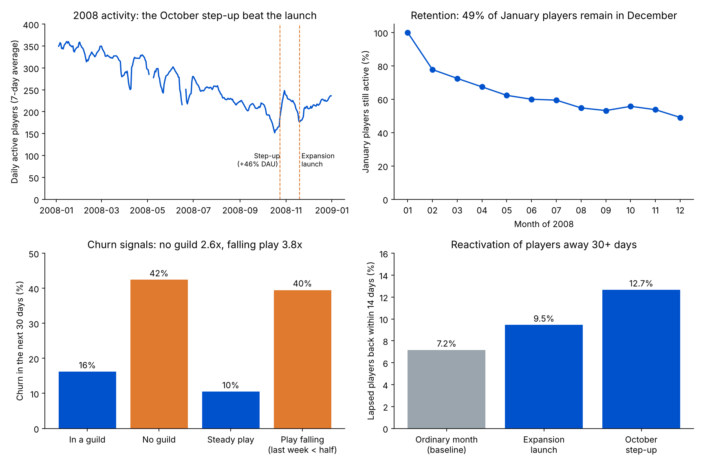

# Game LiveOps Retention: Content Launches, Churn Signals and an Early-Warning Agent

A LiveOps analysis of real player telemetry from World of Warcraft. It measures how players are retained over a year, what a major content launch actually did to activity and to lapsed players, which behaviours signal churn, and how an early-warning model could drive an agentic LiveOps system with guardrails and evals.

**Data:** the *World of Warcraft Avatar History* (WoWAH) dataset (Lee et al., 2011). Every 10 minutes, a bot recorded each online character's level, zone and guild on one realm. This project uses all of 2008 for characters with IDs 1–10,000: **1,766 players**, **1.38M snapshots**, about **230,000 hours** of play and **146,000 sessions**.



## Key findings

| Area | Finding | LiveOps lever |
|---|---|---|
| Data checks | **553** exact duplicate snapshots removed. **14 days** have no snapshots at all; these are recording gaps on the dataset's side, so daily metrics skip them rather than reading them as zero. | Separate telemetry gaps from real drops before any alert fires |
| Retention | Of the **944** players active in January, **78%** were still playing in February, **60%** in June and **49%** in December. The steepest drop is in the first month. | Protect month one: early-life churn is the biggest leak |
| Content launch | The *Wrath of the Lich King* expansion (level cap 70 → 80) reached this realm on **19 Nov 2008** (the first day any character passed level 70). In the 3 weeks after, daily active players were flat (**−4%**), but **hours per active player rose 33%** (1.8 → 2.4 hours a day). | A big content drop deepened engagement more than it widened the player base |
| Reactivation | Of **920** players away for 30+ days before the launch, **9.5%** came back within 14 days, against a **7.2%** baseline on ordinary dates (**1.3x**). | Content alone brings few lapsed players back; pair launches with a targeted comeback message |
| Level-up pace | Only **20%** of the 430 level-70 players who played after the launch reached the new cap of 80 by 31 Dec (median **24.5 days**). | Pacing and catch-up mechanics matter for the majority who level slowly |
| A bigger event | Activity stepped up on **24 Oct 2008**: daily active players rose **46%** and **12.7%** of lapsed players returned within 14 days, **1.8x** the baseline. That beat the launch itself. The data does not say what happened that day; the timing fits the pre-expansion patch, but I could not verify it. | Pre-launch events can be the stronger reactivation moment |
| Churn signals | Across **7,766** player-months, **22%** of active players stop for 30+ days. Players outside a guild churn at **42%** vs **16%** in a guild (**2.6x**). Players whose last week was under half their 4-week average churn at **40%** vs **10%** (**3.8x**). | Social ties and falling play are the earliest warnings |
| Early warning | A gradient-boosting model, trained on Feb–Jul and tested on unseen Aug–Oct months, predicts 30-day churn with AUC **0.86** (a days-since-last-play rule scores 0.82). Its top **20%** of players hold **53%** of churners, and **60%** of them churn. | Rank players daily and act on the top of the list |

## From analysis to an agentic LiveOps system

The early-warning model is the decision engine; an agent would run it every day:

1. **Score:** every active player gets a churn risk from the last 28 days of play.
2. **Act:** for the top-risk players, pick one intervention: a guild invite or matchmaking nudge for solo players, a catch-up quest or XP boost for players falling behind the new level cap, and a comeback reward for players away 30+ days around a content event.
3. **Guardrails:** a frequency cap (no player contacted more than once a week), a spend cap on rewards, and a fixed **10% holdout** that never receives interventions.
4. **Evals:** precision of the top-20% list (the share who would have churned), and retention uplift against the holdout, reported per intervention.
5. **Observability:** a daily dashboard of players scored, actions taken, holdout vs treated retention, and alerts when telemetry has gaps like the 14 missing days above.

## Method

**Sessions.** Consecutive snapshots of a player no more than 30 minutes apart form one session; each snapshot is 10 minutes of play.

**Retention.** Of players active in January, the share with at least one snapshot in each later month.

**Content launch.** Launch day = the first day any character in the data is above level 70, which matches the expansion's release in the Asia region (18 Nov 2008) plus launch-day maintenance; the day before launch shows very low activity and is excluded. Daily active players and hours per active player are averaged over the 21 days after launch and the 21 days before it.

**Reactivation.** For a date D: lapsed players = played before D but not in the 30 days before D; reactivated = played within 14 days after D. Baseline = the same measure averaged over five ordinary dates (13 May, June, July, August and September 2008).

**Churn.** On the 1st of each month from Feb to Nov 2008, every player active in the previous 28 days is labelled churned if they do not play in the next 30 days. Falling play = hours in the last 7 days below half of the 4-week weekly average.

**Early-warning model.** `HistGradientBoostingClassifier` on hours, active days, sessions and zones in the last 28 days, hours in the last 7 days, level, being at the level cap, guild membership, the play trend and days since last play. Trained on Feb–Jul snapshots, tested on Aug–Oct snapshots it never saw. Capture at 20% = share of all churners among the top 20% of players by risk.

## Limitations

- One realm in 2008, Horde characters only, and only characters with IDs 1–10,000: a sample of the realm, not all of it. 822 of the 1,766 characters first appear after January (164 of them at level 5 or below), so the sample mixes returning, existing and new characters; the retention curve follows the January group only.
- The launch and step-up comparisons are before/after, not controlled experiments; other things changed at the same time. An A/B test with a holdout is the way to prove an intervention's effect.
- The dataset records characters, not accounts, so one person playing two characters counts twice.

## Outputs

- `results/results.json`: every number in this README
- `results/daily_active_players.csv`: daily active players for 2008
- `results/churn_features.csv`: the monthly player features and churn labels used for the model
- `results/summary.png`: the four charts above

## Run it

```bash
pip install pandas numpy scikit-learn matplotlib
python get_data.py       # only if data/ is empty: downloads the data into data/
python run_analysis.py   # writes results/ (about 1 minute)
python make_charts.py    # writes results/summary.png
```

## Data source

Y.-T. Lee, K.-T. Chen, Y.-M. Cheng and C.-L. Lei, "World of Warcraft Avatar History Dataset", ACM MMSys 2011 (also on Kaggle as "warcraft-avatar-history"). `get_data.py` downloads the 2008 sample of characters 1–10,000 from a public GitHub repository.
